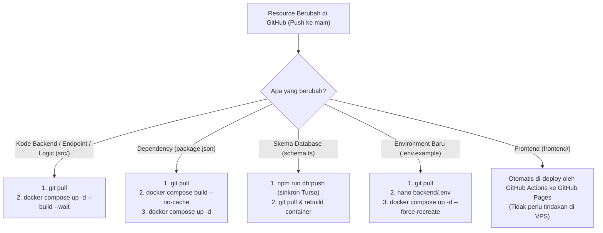

# Panduan Update Docker Image di VPS Saat Resource / Kode Berubah dari GitHub

Panduan ini menjelaskan alur lengkap dan praktis untuk **memperbarui Docker image dan container backend di VPS** ketika ada perubahan resource (fitur baru, perbaikan bug, dependency, skema database, atau konfigurasi) yang telah di-*push* ke GitHub.

---

## ⚡ Ringkasan Cepat (*Quick Cheat-Sheet*)

Jika Anda hanya mengubah kode/resource backend dan sudah push ke branch `main`, jalankan perintah berikut di terminal VPS:

```bash
# Masuk ke folder repo, pull perubahan, rebuild image, dan restart container
cd /opt/si-zat_ESD && \
git pull origin main && \
cd backend && \
docker compose up -d --build --wait && \
docker image prune -f
```

Periksa apakah backend sudah berjalan normal:
```bash
docker compose ps
curl -s http://127.0.0.1:8080/api/health
```

---

## 🧭 Panduan Berdasarkan Jenis Resource yang Berubah

Tidak semua perubahan di GitHub ditangani dengan cara yang sama. Kenali tipe resource yang Anda ubah:



---

## 🛠️ Langkah Demi Langkah di VPS

### Langkah 1: Masuk ke Server VPS
Gunakan SSH dari terminal komputer Anda:
```bash
ssh user@ip-vps-anda
```

### Langkah 2: Ambil Perubahan Terbaru dari GitHub (`git pull`)
Arahkan ke direktori repositori di VPS:
```bash
cd /opt/si-zat_ESD

# Pastikan branch berada di main dan tarik commit terbaru
git pull origin main
```
> [!TIP]
> Jika `git pull` menolak karena ada perubahan lokal di VPS, periksa dengan `git status`. Hindari mengedit file proyek langsung di VPS kecuali file konfigurasi `backend/.env`.

---

### Langkah 3: Update & Rebuild Docker Image

Masuk ke folder `backend`:
```bash
cd /opt/si-zat_ESD/backend
```

Pilih perintah sesuai kondisi:

#### Opsi A: Update Rutin (Standar)
Docker akan mendeteksi file mana saja yang berubah dan meng-invalidate cache layer yang relevan:
```bash
docker compose up -d --build --wait
```
- `--build`: Memaksa pembuatan ulang (*rebuild*) Docker image dengan kode terbaru.
- `-d`: Menjalankan container di latar belakang (*detached*).
- `--wait`: Menunggu health check endpoint (`/api/health`) berstatus **healthy** sebelum proses dianggap selesai.

#### Opsi B: Jika Mengubah Dependency atau Cache Bermasalah (*Fresh Build*)
Gunakan flag `--no-cache` jika ada perubahan package/library (`package.json`, `package-lock.json`) atau jika perubahan resource tidak tampak:
```bash
docker compose build --no-cache backend
docker compose up -d --wait
```

---

### Langkah 4: Verifikasi Status Container

Pastikan container baru telah aktif dan sehat:

1. **Cek status container:**
   ```bash
   docker compose ps
   ```
   *Pastikan kolom STATUS menampilkan `Up ... (healthy)`.*

2. **Cek log aplikasi:**
   ```bash
   docker compose logs --tail=50 backend
   ```

3. **Uji endpoint health secara lokal:**
   ```bash
   curl -i http://127.0.0.1:8080/api/health
   ```
   *Respons yang diharapkan: `HTTP/1.1 200 OK` dengan status `{"status":"ok",...}`.*

---

### Langkah 5: Bersihkan Image Lama (*Disk Housekeeping*)
Setiap kali Anda me-rebuild image, image versi lama akan menjadi *dangling image* (`<none>:<none>`) yang memakan kapasitas penyimpanan disk VPS.

Jalankan pembersihan rutin:
```bash
docker image prune -f
```

---

## 🗄️ Penanganan Khusus: Perubahan Database & Konfigurasi

### 1. Jika Ada Perubahan Skema Database (`schema.ts`)
Aplikasi menggunakan **Turso (libsql)** yang berada di cloud dan skema dikelola melalui **Drizzle ORM**. Container backend tidak menjalankan migrasi otomatis saat start.

Langkah:
1. Jalankan sinkronisasi skema dari komputer pengembang (atau dari VPS yang memiliki file `backend/.env`):
   ```bash
   cd backend
   npm run db:push
   ```
2. Pastikan perubahan skema berhasil diterapkan di Turso.
3. Lakukan update Docker image di VPS seperti biasa (Langkah 3).

### 2. Jika Ada Environment Variable Baru
File `.env` diabaikan oleh Git demi keamanan:
1. Buka file `.env` di VPS:
   ```bash
   nano /opt/si-zat_ESD/backend/.env
   ```
2. Tambahkan/sesuaikan variabel yang diperlukan.
3. Restart container agar membaca konfigurasi baru:
   ```bash
   cd /opt/si-zat_ESD/backend
   docker compose up -d --force-recreate
   ```

---

## 🔄 Prosedur Rollback (Jika Terjadi Error Pasca Update)

Jika image baru mengalami masalah di server produksi, Anda bisa mengembalikan versi secara cepat:

```bash
cd /opt/si-zat_ESD

# 1. Cek riwayat commit sebelumnya
git log --oneline -5

# 2. Checkout ke commit yang stabil sebelumnya (ganti <commit-hash>)
git checkout <commit-hash>

# 3. Rebuild dan jalankan ulang container versi sebelumnya
cd backend
docker compose up -d --build --wait
```

Setelah masalah diperbaiki di GitHub, kembalikan branch VPS ke `main`:
```bash
cd /opt/si-zat_ESD
git checkout main
git pull origin main
cd backend
docker compose up -d --build --wait
```

---

## ❓ FAQ & Solusi Masalah (*Troubleshooting*)

| Masalah | Penyebab | Solusi |
| :--- | :--- | :--- |
| **Perubahan kode tidak terlihat di web** | Docker menggunakan layer build cache lama. | Jalankan `docker compose build --no-cache backend && docker compose up -d`. |
| **Status container `unhealthy` atau restart terus-menerus** | Konfigurasi `.env` salah, token Turso kedaluwarsa, atau crash runtime. | Jalankan `docker compose logs --tail=100 backend` untuk membaca pesan error node.js. |
| **Error `npm ci` saat build** | `package.json` dan `package-lock.json` tidak sinkron. | Pastikan `npm install` sudah dijalankan di lokal sebelum di-commit & push ke GitHub. |
| **Ruang disk VPS penuh (*no space left on device*)** | Image lama menumpuk. | Jalankan `docker system prune -a --volumes` (hati-hati, hanya menghapus container/image yang tidak terpakai). |
